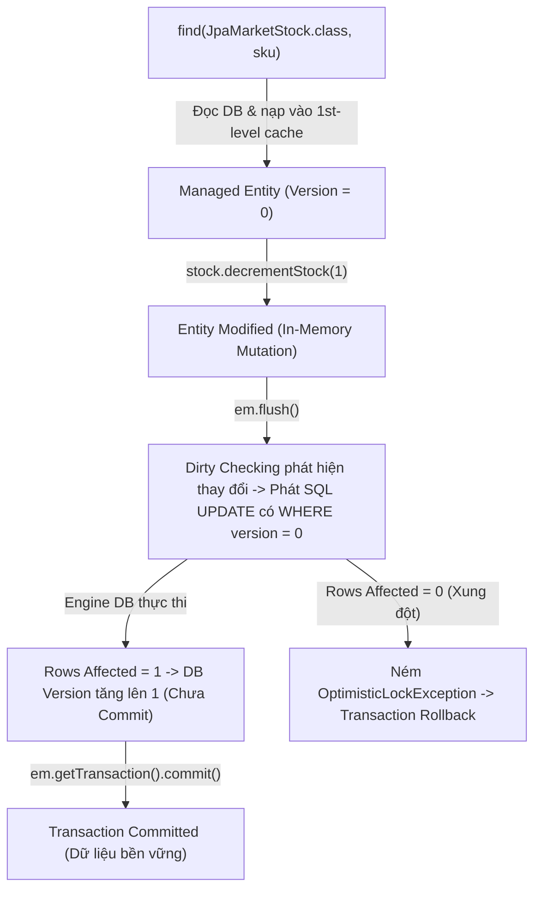

# M2-E1C: JPA @Version, Persistence Context, Flush & Commit Lifecycle

**Module:** M2 — Database & Concurrency  
**Lab Code:** M2-E1C  
**Chủ đề:** Cơ chế Optimistic Locking tự động của JPA `@Version`, Persistence Context (First-level cache), Dirty Checking, sự khác biệt giữa `flush()` và `commit()`, và nguyên tắc xử lý ngoại lệ / retry với `EntityManager`.  
**Trạng thái kiểm chứng Runtime:** `VERIFIED` trên PostgreSQL 16.15 thật (Hibernate ORM 6.5.3.Final via Testcontainers 1.21.4).

---

## 1. Trực giác Thực tế: "Bản Phiếu Tồn Kho Mang Số Phiên Bản Cũ"

Hãy tưởng tượng quầy thủ kho nhận phiếu xuất hàng:
1. Bạn An và Bạn Bình cùng nhìn lên bảng tồn kho vào đầu ngày và ghi vào sổ tay của mình: `SKU = NETHER_STAR, Có sẵn = 2, Version = 0`.
2. Bạn An xử lý xong đơn hàng 1 món, mang phiếu lên quầy và nói: *"Tôi cập nhật kho dựa trên bản ghi Version 0 nhé"*. Thủ kho kiểm tra thấy bảng vẫn là Version 0, đồng ý trừ kho xuống 1 và đóng dấu thành **Version 1**.
3. Vài giây sau, Bạn Bình cũng mang phiếu lên và bảo: *"Tôi cũng cập nhật kho dựa trên bản ghi Version 0 của tôi"*.
4. Thủ kho lập tức từ chối: *"Không được! Bảng kho hiện tại đã là Version 1 rồi. Bản phiếu của bạn mang số phiên bản cũ (stale version). Bạn phải hủy giao dịch này, quay lại xem bảng kho mới rồi làm lại từ đầu!"*.

Trong Java ORM, Hibernate đóng vai trò người thủ kho, và cột `@Version` chính là con số kiểm soát phiên bản đó.

---

## 2. Vòng đời Xử lý Dữ liệu trong JPA (Entity Lifecycle & Flush vs Commit)

### Các giai đoạn then chốt:
1. **First-level Cache (Persistence Context):**
   - Khi gọi `em.find()` nhiều lần cho cùng một ID trong cùng một transaction, Hibernate chỉ truy vấn database ở lần đầu và trả về **chính xác cùng một tham chiếu đối tượng trên Heap** (`s1 == s2` là `true`).
2. **Dirty Checking:**
   - Hibernate lưu snapshot trạng thái ban đầu của managed entity. Khi transaction kết thúc hoặc khi gọi `flush()`, Hibernate tự động so sánh trạng thái hiện tại với snapshot để xác định những trường nào bị thay đổi.
   - Bạn **không cần gọi method `save()` hay `update()`**; chỉ cần thay đổi field trên managed entity, Hibernate sẽ tự động sinh câu lệnh SQL `UPDATE`.
3. **Flush không phải là Commit:**
   - `em.flush()` đồng bộ hóa các thay đổi đang chờ trong memory xuống socket của PostgreSQL bằng các câu lệnh SQL (`INSERT`, `UPDATE`, `DELETE`).
   - Tuy nhiên, giao dịch database **vẫn đang mở**. Dưới mức cô lập mặc định `READ COMMITTED`, các kết nối khác ngoài transaction hoàn toàn **chưa nhìn thấy** dữ liệu này.
   - Nếu transaction bị rollback sau khi đã flush, toàn bộ các câu lệnh SQL đã gửi đều bị PostgreSQL hủy bỏ nguyên vẹn.
4. **Thời điểm phát hiện Optimistic Lock Conflict:**
   - **Khi gọi `em.flush()`:** Câu lệnh `UPDATE ... WHERE sku = ? AND version = ?` được thực thi ngay. Nếu có transaction khác đã commit trước làm version tăng lên, câu lệnh UPDATE trả về `0 rows affected`. Hibernate lập tức ném `jakarta.persistence.OptimisticLockException`.
   - **Khi không gọi `flush()`:** Câu lệnh UPDATE được hoãn lại cho tới khi gọi `em.getTransaction().commit()`. Khi đó, conflict xảy ra tại **ranh giới commit**, và phương thức `commit()` sẽ ném ra `jakarta.persistence.RollbackException` bọc lấy `OptimisticLockException`.

---

## 3. Bảng So Sánh: JDBC Manual Version Check vs Hibernate `@Version`

| Tiêu chí | M2-E1B: JDBC Manual Version Check | M2-E1C: Hibernate JPA `@Version` |
|---|---|---|
| **Cơ chế quản lý version** | Lập trình viên phải tự SELECT version, tự nhét `WHERE version = ?` vào SQL UPDATE, tự kiểm tra `rowsAffected == 0` và tự ném exception. | Khai báo annotation `@Version` trên field `version`. Hibernate tự động chèn mệnh đề `WHERE version = ?` vào mọi câu lệnh UPDATE sinh ra. |
| **Giá trị version trên Java Object** | Lập trình viên phải tự tăng hoặc tự map từ snapshot DB. | Hibernate tự quản lý. Lập trình viên **tuyệt đối không được can thiệp** vào giá trị của field version trong code nghiệp vụ. |
| **First-level Cache** | Không có. Mỗi lần query là một chuyến đi độc lập tới DB. | Có Persistence Context. Hai lần `find()` cùng PK trả về cùng một instance duy nhất. |
| **Thời điểm phát SQL** | Ngay lập tức khi gọi `jdbcTemplate.update()`. | Trì hoãn (write-behind) cho tới khi gọi `em.flush()` hoặc khi commit transaction. |
| **Xử lý khi Conflict** | Service ném `StockVersionConflictException`. | Provider ném `OptimisticLockException` (tại `flush()`) hoặc `RollbackException` (tại `commit()`). |
| **Khả năng tái sử dụng Transaction** | Transaction bị rollback-only; caller phải mở transaction mới hoàn toàn để retry. | `EntityManager` bị đánh dấu hỏng/rollback; caller **phải đóng `EntityManager` cũ và tạo `EntityManager` mới** cùng transaction mới để retry. |

---

## 4. Timeline Thực nghiệm: Hai Persistence Context Cạnh tranh

*Kịch bản thực tế đã kiểm chứng trong `JpaVersionExperimentsTest.jpa2_twoPersistenceContexts_conflictAtExplicitFlush`:*

| Thời gian | Worker 1 (Thread A) | Worker 2 (Thread B) | Trạng thái PostgreSQL (`market_stock`) |
|:---:|---|---|:---:|
| $T_0$ | Seed database | Seed database | `available = 2, version = 0` |
| $T_1$ | `em1.getTransaction().begin()` `s1 = em1.find(..., "NETHER_STAR")` Đọc được: `version = 0, available = 2` | `em2.getTransaction().begin()` `s2 = em2.find(..., "NETHER_STAR")` Đọc được: `version = 0, available = 2` | `available = 2, version = 0` |
| $T_2$ | **Đồng bộ qua Barrier:** Cả 2 cùng xác nhận đã cầm snapshot `version = 0` | |
| $T_3$ | `s1.decrementStock(1)` `em1.persist(purchase1)` `em1.flush()` $\rightarrow$ phát SQL UPDATE v0 `em1.getTransaction().commit()` | Đang chờ Worker 1 hoàn tất | `available = 1, version = 1` *(Đã commit)* |
| $T_4$ | Đã đóng `em1` | `s2.decrementStock(1)` `em2.persist(purchase2)` `em2.flush()` $\rightarrow$ phát SQL UPDATE với `WHERE version = 0` | Câu lệnh UPDATE tác động vào 0 dòng do version trên DB đã là 1! |
| $T_5$ | - | Hibernate phát hiện 0 dòng cập nhật $\rightarrow$ Ném **`OptimisticLockException`**! | `available = 1, version = 1` |
| $T_6$ | - | Bắt exception, gọi `em2.getTransaction().rollback()`, đóng `em2`. | `available = 1, version = 1` *(Bảo toàn bất biến)* |

---

## 5. Nguyên tắc Vàng: Không Bao Giờ Tái Sử Dụng EntityManager Đã Bị Lỗi

Khi một giao dịch trong `EntityManager` gặp ngoại lệ (như `OptimisticLockException`, `ConstraintViolationException`), trạng thái của Persistence Context bị coi là **không còn đáng tin cậy** (corrupted in-memory state):
- Nếu bạn cố tình bắt exception rồi gọi tiếp các thao tác ghi khác trên cùng `EntityManager`, provider sẽ ném ngoại lệ hoặc đẩy dữ liệu sai lệch xuống DB.
- **Quy trình retry đúng chuẩn:**
  1. `catch (OptimisticLockException ex)`
  2. Rollback transaction hiện tại: `if (em.getTransaction().isActive()) em.getTransaction().rollback();`
  3. Đóng `EntityManager` cũ: `em.close();`
  4. Mở một `EntityManager` mới hoàn toàn: `EntityManager freshEm = emf.createEntityManager();`
  5. Mở transaction mới, đọc lại dữ liệu đã commit mới nhất từ DB, thực hiện logic nghiệp vụ và commit.

---

## 6. Giới Hạn Cần Nhớ (Scope Boundaries)

1. Bài lab M2-E1C là bài thực nghiệm **JPA / Hibernate thuần túy (Java SE bootstrap)** nhằm giúp bạn hiểu bản chất hoạt động của ORM engine bên dưới.
2. Lab **chưa bao gồm**:
   - Spring Data JPA repository (`JpaRepository`, `save()`, `saveAndFlush()`).
   - Spring transaction management proxy (`@Transactional`, transaction interceptor, self-invocation gotchas).
   - Cơ chế dịch ngoại lệ tự động của Spring (`PersistenceExceptionTranslationPostProcessor` dịch sang `OptimisticLockingFailureException`).