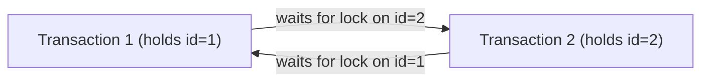

# M2-E2A: PostgreSQL Deadlock, Thứ Tự Khóa và Retry Toàn Transaction

**Mã thí nghiệm:** M2-E2A  
**Môi trường:** Spring Boot 3.3.4, Spring Framework 6.1.13, HikariCP, PostgreSQL 16.15 (Testcontainers), Java 22  
**Mục tiêu:** Giải phẫu hiện tượng Deadlock ở tầng cơ sở dữ liệu quan hệ, cơ chế phát hiện chu trình chờ (wait-for cycle) của PostgreSQL, giải pháp sắp xếp thứ tự khóa nhất quán (Lock Ordering), và chiến lược retry toàn bộ transaction boundary khi trở thành nạn nhân (Victim).

---

## 1. Bản Chất Kỹ Thuật: Từ Ví Dụ Đời Thường Đến Khóa Hàng Cơ Sở Dữ Liệu

### 1.1. Ví dụ đời thường
Hãy tưởng tượng hai người thợ cùng lắp ráp một cỗ máy:
- Thợ 1 cầm chiếc cờ-lê (Tài nguyên A) và đang chờ chiếc kìm (Tài nguyên B).
- Thợ 2 cầm chiếc kìm (Tài nguyên B) và đang chờ chiếc cờ-lê (Tài nguyên A).
- Cả hai người đều giữ chặt công cụ mình đang có và kiên quyết không buông cho đến khi lấy được công cụ còn lại. Nếu không có ai can thiệp, hai người sẽ đứng nhìn nhau vô tận.

### 1.2. Ánh xạ sang Khóa Hàng (Row-Level Locks) trên PostgreSQL
Trong cơ sở dữ liệu quan hệ, kịch bản trên diễn ra chính xác giữa hai Transaction đồng thời:
- **Transaction 1 (T1):** Thực thi `UPDATE deadlock_counter SET value = value + 1 WHERE id = 1`. PostgreSQL cấp cho T1 một khóa độc quyền hàng (`Exclusive Row Lock` / `FOR UPDATE`) trên hàng `id = 1`.
- **Transaction 2 (T2):** Thực thi `UPDATE deadlock_counter SET value = value + 1 WHERE id = 2`. PostgreSQL cấp cho T2 một khóa độc quyền hàng trên hàng `id = 2`.
- Sau đó, **T1** cố gắng cập nhật `id = 2`: T1 bị chặn (blocked) và đưa vào hàng đợi chờ T2 nhả khóa.
- Đồng thời, **T2** cố gắng cập nhật `id = 1`: T2 bị chặn và đưa vào hàng đợi chờ T1 nhả khóa.
- **Chu trình chờ (Wait-for Cycle):** T1 chờ T2, và T2 chờ T1 (T1 -> T2 -> T1). Không bên nào có thể tiếp tục.

---

## 2. Kết Quả Đo Đạc Ba Kịch Bản Bắt Buộc (DL1 – DL3)

Các kịch bản được thực nghiệm tự động trong PostgresDeadlockExperimentsTest trên bảng kiểm thử cô lập `deadlock_counter (id INT, value BIGINT)` và `deadlock_operation (operation_id UUID)`.

### Bảng Đối Chiếu Kỳ Vọng (Expected) vs Quan Sát Thực Tế (Observed)

| Kịch bản | Attempts | Commits | Deadlock Victims | Giá trị A | Giá trị B | Markers Committed | SQLSTATE Quan Sát | Trạng Thái Invariant |
| :--- | :---: | :---: | :---: | :---: | :---: | :---: | :---: | :---: |
| **DL1: Deadlock có kiểm soát** | 2 | 1 | 1 | 1 | 1 | 1 | `40P01` | **HỢP LỆ:** A = B = 1 |
| **DL2: Thứ tự khóa nhất quán [1,2]** | 2 | 2 | 0 | 2 | 2 | 2 | *(Không có lỗi)* | **HỢP LỆ:** A = B = 2 |
| **DL3: Retry toàn transaction** | 3 | 2 | 1 (ở phase đầu) | 2 | 2 | 2 | `40P01` (attempt 1) | **HỢP LỆ:** A = B = 2 |

---

## 3. Phân Tích Chuyên Sâu Từng Kịch Bản

### 3.1. DL1 — Tái Hiện Deadlock Có Kiểm Soát (SQLSTATE 40P01)
- Hai worker chạy trên hai kết nối PostgreSQL độc lập (PID 61 và PID 62):
  - Worker 1: Insert marker 1 -> `UPDATE id=1` -> Đợi barrier.
  - Worker 2: Insert marker 2 -> `UPDATE id=2` -> Đợi barrier.
  - Sau barrier, Worker 1 gọi `UPDATE id=2` và Worker 2 gọi `UPDATE id=1`.
- **Cơ chế PostgreSQL Engine:**
  - PostgreSQL không kiểm tra deadlock liên tục trên mỗi câu lệnh để tránh suy giảm hiệu năng. Khi một connection bị block, PostgreSQL kích hoạt bộ đếm thời gian `deadlock_timeout` (mặc định 1 giây).
  - Khi hết 1 giây mà connection vẫn bị chặn, background process của PostgreSQL duyệt đồ thị khóa (lock wait-for graph). Khi phát hiện chu trình khép kín, PostgreSQL chủ động chọn một transaction làm **Nạn nhân (Victim)** và hủy câu lệnh của nó với mã lỗi:
    `ERROR: deadlock detected` (SQLSTATE: 40P01).
- **Tính toàn vẹn (ACID Atomicity):**
  - Transaction nạn nhân bị Spring rollback toàn bộ.
  - Dù Worker 2 đã ghi nhận `operation_id` và đã tăng giá trị một hàng trước barrier, khi deadlock xảy ra, **toàn bộ dữ liệu của Worker 2 bị hủy hoàn toàn** (marker biến mất, số đếm không tăng).
  - Transaction sống sót (Survivor) commit thành công: A=1, B=1, chỉ có marker của survivor tồn tại.

---

### 3.2. DL2 — Lấy Khóa Theo Thứ Tự Nhất Quán (Lock Ordering)
- Cả hai thao tác đều chuẩn hóa thứ tự cập nhật các hàng theo ID tăng dần: `[1, 2]`.
- **Thực nghiệm chứng minh Contention:**
  - Worker 1 cập nhật `id = 1` và giữ transaction mở qua một chốt (`CountDownLatch`).
  - Worker 2 công bố PID của mình rồi gọi `UPDATE id = 1`. Vì Worker 1 đang giữ khóa, Worker 2 rơi vào trạng thái blocked.
  - Observer bên ngoài xác thực qua hàm hệ thống của PostgreSQL:
    `SELECT ? = ANY(pg_blocking_pids(?))` -> Trả về `true` (chứng minh Worker 2 bị Worker 1 chặn thật sự).
  - Giải phóng chốt của Worker 1 -> Worker 1 cập nhật `id = 2` và commit.
  - Worker 2 được giải phóng -> Cập nhật `id = 1`, tiếp tục cập nhật `id = 2` và commit.
- **Kết luận:**
  - Cả hai commit thành công, không phát sinh `40P01`.
  - Invariant đạt trạng thái hoàn hảo: A=2, B=2, cả 2 marker tồn tại.
- **Giới hạn thực tế:** Thứ tự tăng dần loại bỏ chu trình cho hai tài nguyên trong fixture này. Trong hệ thống phức tạp với nhiều bảng liên kết, Foreign Key cascaded locks, Index locks (gap locks), hoặc các luồng batch/reporting chạy song song, chỉ sắp xếp một bảng là chưa đủ để triệt tiêu mọi nguy cơ deadlock.

---

### 3.3. DL3 — Retry Toàn Transaction Sau Deadlock
Khi một transaction bị chọn làm victim của deadlock (`40P01`), câu hỏi kinh điển trong phỏng vấn là: *Có thể chỉ gọi lại câu lệnh SQL vừa bị lỗi không?*

- **Câu trả lời dứt khoát: KHÔNG.**
  - Khi PostgreSQL ném lỗi `40P01`, transaction hiện tại đã rơi vào trạng thái hỏng (`aborted state / in failed transaction block`). Mọi lệnh SQL tiếp theo trong cùng transaction đó đều bị PostgreSQL từ chối với lỗi: `ERROR: current transaction is aborted, commands ignored until end of transaction block (SQLSTATE 25P02)`.
  - Hơn nữa, toàn bộ các câu lệnh đã thực hiện trước đó của victim (như insert marker, update hàng đầu tiên) đã bị ROLLBACK hoàn toàn. Nếu chỉ retry câu lệnh thứ hai, transaction sẽ thiếu dữ liệu của các bước đầu, phá vỡ tính bất biến nghiệp vụ.
- **Chiến lược Retry Chuẩn:**
  1. Cho phép transaction lỗi rollback hoàn toàn ra khỏi ranh giới transaction ban đầu.
  2. Bắt ngoại lệ deadlock ở tầng điều phối ứng dụng (Caller / Orchestrator) bên ngoài `TransactionTemplate.execute()` hoặc ngoài Spring Proxy.
  3. Mở một **Transaction Mới Hoàn Toàn** (`status.isNewTransaction() == true`).
  4. Thực nghiệm kiểm chứng: Thu thập `SELECT txid_current()` chứng minh transaction ID của lần retry (`751`) khác biệt hoàn toàn với transaction ID của lần thất bại (`749`).
  5. Thực thi lại toàn bộ chu trình nghiệp vụ: insert marker -> update A -> update B -> commit.
  6. Kết quả sau retry: A=2, B=2, phục hồi toàn vẹn 2 operation markers.

---

## 4. Bảng Phân Biệt Các Loại Lỗi Khóa & Ngoại Lệ

| Ngoại lệ / Mã lỗi | SQLSTATE / Lớp lỗi | Nguyên nhân gốc | Transaction có bị hủy tự động? | Hướng xử lý đúng |
| :--- | :--- | :--- | :--- | :--- |
| **Deadlock Detected** | **`40P01`** | Chu trình chờ khóa giữa 2 hoặc nhiều transactions | **CÓ** (PostgreSQL engine hủy câu lệnh của victim) | Bắt lỗi ngoài transaction boundary, retry toàn bộ transaction mới. |
| **Lock Timeout** | **`55P03`** | Chờ lấy khóa vượt quá cấu hình `lock_timeout` | **CÓ** (Câu lệnh bị hủy) | Kiểm tra nghẽn transaction, tối ưu câu truy vấn, retry có backoff. |
| **Statement Timeout** | **`57014`** | Thời gian thực thi câu lệnh vượt quá `statement_timeout` | **CÓ** (Câu lệnh bị hủy) | Tối ưu hóa query execution plan, index, phân trang. |
| **Java Monitor Deadlock** | `java.lang.Thread` (BLOCKED) | Tranh chấp khóa `synchronized` hoặc `ReentrantLock` trong JVM heap | **KHÔNG** (Thread treo vĩnh viễn, JVM không có bộ ngắt tự động) | Thread dump (`jstack`), sửa thứ tự acquire lock trong Java code. |
| **Spring Rollback-Only** | `UnexpectedRollbackException` | Do AOP advice phát hiện unchecked exception ở method con (PR2) | **CÓ** (Spring AOP từ chối commit ở outer boundary) | Tách propagation (`REQUIRES_NEW`), thiết kế lại exception handling. |

---

## 5. Cảnh Báo Kiến Trúc & Giới Hạn Thực Nghiệm

1. **`deadlock_timeout` không phải là thời gian tối đa của query:**
   Tham số `deadlock_timeout = 1s` chỉ là khoảng thời gian PostgreSQL cho phép một transaction chờ khóa trước khi khởi động tiến trình kiểm tra chu trình đồ thị. Các câu lệnh thông thường nếu không có chu trình chờ vẫn có thể tiếp tục chờ cho đến khi đạt `lock_timeout`.
2. **Khóa thứ tự không thay thế được Transaction Timeout:**
   Dù đã chuẩn hóa thứ tự `[1, 2]`, nếu Transaction 1 cập nhật hàng 1 rồi thực hiện gọi API mạng (HTTP REST / gRPC) mất 30 giây, Transaction 2 vẫn sẽ bị nghẽn (hang) 30 giây chờ hàng 1. Do đó, tuyệt đối không gọi I/O mạng bên trong transaction khóa hàng.
3. **Phạm vi áp dụng đối với CV:**
   Thực nghiệm này mô hình hóa cơ chế nền tảng của tranh chấp khóa hai hàng trên PostgreSQL. Bài toán thực tế khi import dữ liệu lớn (Batch Upsert) còn liên quan đến Unique Index conflicts, Bulk insert lock escalation, và Database partitioning. Lab này xác nhận cơ chế nguyên tử và retry, không đóng vai trò bằng chứng thay thế cho hệ thống import cụ thể trong CV.
