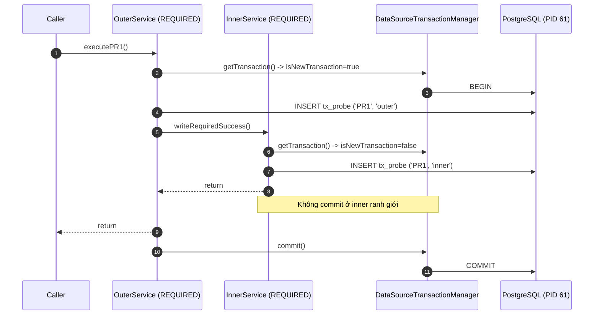
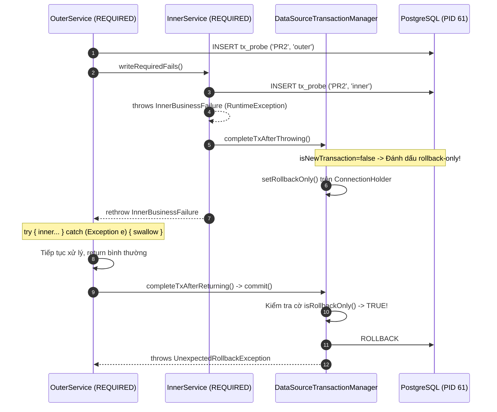

# M2-E3B: Spring Transaction Propagation & Rollback Rules trên PostgreSQL

**Mã thí nghiệm:** M2-E3B  
**Môi trường:** Spring Boot 3.3.4, Spring Framework 6.1.13, HikariCP, PostgreSQL 16.15 (Testcontainers), Java 22  
**Mục tiêu:** Giải phẫu cơ chế lan truyền giao dịch (`Propagation`), trạng thái giao dịch vật lý (`Physical Transaction`) vs giao dịch logic (`Logical Transaction`), cơ chế rollback-only flag, connection suspension, và savepoints.

---

## 1. Cơ sở lý thuyết: Logical Transaction vs Physical Transaction

Trong Spring Framework, quản lý giao dịch khai báo (`@Transactional`) phân tách rạch ròi giữa **Logical Transaction Boundary** (phạm vi của từng method được đánh dấu) và **Physical Transaction Boundary** (kết nối JDBC thực tế và phiên giao dịch SQL `BEGIN ... COMMIT/ROLLBACK` trên Database Engine).

### 1.1. Bảng phân loại `Propagation`
Spring cung cấp 7 mức lan truyền qua enum `org.springframework.transaction.annotation.Propagation`:

| Propagation | Hành vi khi ĐÃ CÓ Transaction | Hành vi khi CHƯA CÓ Transaction | Số Physical Connection |
| :--- | :--- | :--- | :--- |
| **`REQUIRED`** *(mặc định)* | Tham gia vào transaction hiện tại (Join logical tx) | Mở physical transaction mới | 1 (dùng chung) |
| **`REQUIRES_NEW`** | Tạm dừng (suspend) tx hiện tại, mở physical tx mới độc lập | Mở physical transaction mới | **2 đồng thời** (thread giữ cả 2) |
| **`NESTED`** | Tạo JDBC `Savepoint` trong physical tx hiện tại | Mở physical transaction mới | 1 (dùng chung) |
| **`SUPPORTS`** | Chạy trong transaction hiện tại | Chạy không có transaction | 0 hoặc 1 |
| **`NOT_SUPPORTED`** | Tạm dừng transaction hiện tại, chạy non-transactional | Chạy không có transaction | 0 (tạm nhả tx) |
| **`MANDATORY`** | Tham gia transaction hiện tại | **Ném exception** (`IllegalTransactionStateException`) | 1 |
| **`NEVER`** | **Ném exception** (`IllegalTransactionStateException`) | Chạy không có transaction | 0 |

### 1.2. TransactionSynchronizationManager & Thread-Local Storage
Spring quản lý giao dịch thông qua `TransactionSynchronizationManager`:
- **Resources Map (`ThreadLocal<Map<Object, Object>>`)**: Lưu trữ `DataSource -> ConnectionHolder`. Khi transaction bắt đầu, connection được bind vào thread hiện tại.
- **`currentTransactionStatus()`**:
  - `isNewTransaction()`: Trả về `true` nếu method này là nơi khởi tạo physical connection/transaction.
  - `hasSavepoint()`: Trả về `true` nếu method được quản lý bởi JDBC Savepoint (`NESTED`).
  - `isRollbackOnly()`: Cờ đánh dấu transaction vật lý đã bị hỏng và bắt buộc phải rollback khi tới ranh giới commit.

---

## 2. Giải phẫu 6 Kịch bản Thực nghiệm (PR1 – PR6)

Tất cả kịch bản được thực thi và kiểm chứng tự động trong `TransactionPropagationExperimentsTest.java` trên bảng cô lập `tx_probe (id UUID, case_id VARCHAR, phase VARCHAR)`.

```
========================================================================================
Scenario  Outer Prop   Inner Prop    Inner Throws?  Outer Catches?  Outer Throws?  Result
========================================================================================
PR1       REQUIRED     REQUIRED      No             N/A             No             Commit All
PR2       REQUIRED     REQUIRED      Yes (Unchecked) Yes (Swallow)  No             UnexpectedRollbackException
PR3       REQUIRED     REQUIRES_NEW  No             N/A             Yes (Unchecked) Inner Commit, Outer Rollback
PR4       REQUIRED     REQUIRES_NEW  Yes (Unchecked) Yes (Swallow)  No             Inner Rollback, Outer Commit
PR5       REQUIRED     NESTED        Yes (Unchecked) Yes (Swallow)  No             Savepoint Rollback, Outer Commit
PR6       REQUIRED     NESTED        No             N/A             Yes (Unchecked) Rollback All (Savepoint Undone)
========================================================================================
```

---

### PR1 — REQUIRED Baseline (Cùng Physical Transaction)



- **Đo đạc thực tế:**
  - `outerPid = 61`, `innerPid = 61` (Cùng 1 PostgreSQL Backend PID).
  - `outerIsNew = true`, `innerIsNew = false`, `hasSavepoint = false`.
  - Kết quả DB: `outerRows = 1`, `innerRows = 1`.

---

### PR2 — REQUIRED Rollback-Only: Catch Ngoại lệ nhưng Vẫn Thất bại

Đây là lỗi phổ biến bậc nhất trong các ứng dụng Spring Enterprise. Lập trình viên cố gắng bao bọc lệnh gọi `innerService.method()` trong khối `try-catch` để "cứu vãn" luồng xử lý của `outerService`.



- **Bản chất kỹ thuật:**
  1. Khi ngoại lệ unchecked thoát ra khỏi proxy của `innerService`, `TransactionInterceptor` gọi `txManager.rollbackOn(ex)`.
  2. Do `isNewTransaction() == false`, transaction manager **không** gửi lệnh `ROLLBACK` xuống Database ngay (vì outer method chưa hoàn tất). Thay vào đó, nó gọi `status.setRollbackOnly()`, đánh dấu `ConnectionHolder` trong `ThreadLocal`.
  3. Outer method bắt được ngoại lệ, nghĩ rằng lỗi đã được xử lý êm thấm và kết thúc method bình thường.
  4. Ranh giới ngoài cùng (`outerService`) tiến hành commit. `DataSourceTransactionManager` phát hiện cờ `isRollbackOnly() == true` nên từ chối commit, gửi lệnh `ROLLBACK` xuống PostgreSQL và ném ra:
     `org.springframework.transaction.UnexpectedRollbackException: Transaction silently rolled back because it has been marked as rollback-only`.
- **Đo đạc thực tế:**
  - `callerResult = EXCEPTION`, exception là `UnexpectedRollbackException`.
  - DB: `outerRows = 0`, `innerRows = 0`. Toàn bộ dữ liệu bị cuốn trôi.

---

### PR3 — REQUIRES_NEW: Inner Commit Độc Lập, Outer Rollback

`REQUIRES_NEW` chỉ định rằng method được gọi phải thực thi trong một physical transaction hoàn toàn độc lập.

```mermaid
sequenceDiagram
    autonumber
    participant OuterProxy as OuterService (REQUIRED)
    participant InnerProxy as InnerService (REQUIRES_NEW)
    participant TxMgr as DataSourceTransactionManager
    participant PG1 as PostgreSQL Conn 1 (PID 61)
    participant PG2 as PostgreSQL Conn 2 (PID 62)

    OuterProxy->>PG1: BEGIN; INSERT ('PR3', 'outer')
    OuterProxy->>InnerProxy: writeRequiresNewSuccess()
    InnerProxy->>TxMgr: suspend(Conn 1)
    TxMgr->>PG2: Lấy Conn 2 từ Pool -> BEGIN (PID 62)
    InnerProxy->>PG2: INSERT ('PR3', 'inner')
    InnerProxy->>TxMgr: commit(Conn 2)
    TxMgr->>PG2: COMMIT; Trả Conn 2 về Pool
    TxMgr->>InnerProxy: resume(Conn 1)
    InnerProxy-->>OuterProxy: return
    Note over OuterProxy: Mid-Flight Observer (Raw JDBC Conn 3) thấy inner=1, outer=0!
    OuterProxy-->>OuterProxy: throws OuterBusinessFailure
    OuterProxy->>TxMgr: rollback(Conn 1)
    TxMgr->>PG1: ROLLBACK
```

- **Xác minh Mid-Flight Observation:**
  - Trong test PR3, một kết nối độc lập qua `DriverManager.getConnection(...)` được mở **ngay trước khi** outer method ném ngoại lệ.
  - Kết quả quan sát trực tiếp từ PostgreSQL engine: `inner_rows = 1`, `outer_rows = 0` (Outer chưa commit nên connection khác không thấy do Read Committed isolation).
  - Khi Outer rollback: `outerRows = 0`, nhưng `innerRows = 1` vẫn tồn tại bất biến!
- **Đo đạc thực tế:**
  - `outerPid = 61`, `innerPid = 62` (2 backend processes khác nhau).
  - `outerIsNew = true`, `innerIsNew = true`.

---

### PR4 — REQUIRES_NEW: Inner Thất Bại Độc Lập, Outer Bắt Ngoại Lệ và Commit

```mermaid
sequenceDiagram
    autonumber
    participant OuterProxy as OuterService (REQUIRED)
    participant InnerProxy as InnerService (REQUIRES_NEW)
    participant TxMgr as DataSourceTransactionManager
    participant PG1 as PostgreSQL Conn 1 (PID 61)
    participant PG2 as PostgreSQL Conn 2 (PID 62)

    OuterProxy->>PG1: BEGIN; INSERT ('PR4', 'outer')
    OuterProxy->>InnerProxy: writeRequiresNewFails()
    InnerProxy->>TxMgr: suspend(Conn 1); Conn 2 -> BEGIN (PID 62)
    InnerProxy->>PG2: INSERT ('PR4', 'inner')
    InnerProxy-->>InnerProxy: throws InnerBusinessFailure
    InnerProxy->>TxMgr: rollback(Conn 2)
    TxMgr->>PG2: ROLLBACK; Trả Conn 2 về Pool
    TxMgr->>InnerProxy: resume(Conn 1)
    InnerProxy-->>OuterProxy: rethrow InnerBusinessFailure
    Note over OuterProxy: catch (InnerBusinessFailure e) { log and continue }
    OuterProxy->>TxMgr: commit(Conn 1)
    TxMgr->>PG1: COMMIT
```

- **Bản chất kỹ thuật:**
  - Vì Conn 2 là physical transaction riêng biệt, việc Conn 2 rollback chỉ tác động lên Conn 2.
  - Conn 1 (Outer) **không bao giờ bị đánh dấu rollback-only**. Do đó, khi outer catch ngoại lệ và kết thúc bình thường, Conn 1 commit thành công rực rỡ.
- **Đo đạc thực tế:**
  - `callerResult = SUCCESS`.
  - DB: `outerRows = 1`, `innerRows = 0`.

---

### PR5 — NESTED: Rollback Về JDBC Savepoint, Outer Tiếp Tục Commit

`NESTED` sử dụng tính năng **JDBC Savepoint** trên cùng một kết nối vật lý (không lấy connection mới từ pool).

```mermaid
sequenceDiagram
    autonumber
    participant OuterProxy as OuterService (REQUIRED)
    participant InnerProxy as InnerService (NESTED)
    participant TxMgr as DataSourceTransactionManager
    participant PG as PostgreSQL (PID 61)

    OuterProxy->>PG: BEGIN; INSERT ('PR5', 'outer')
    OuterProxy->>InnerProxy: writeNestedFails()
    InnerProxy->>TxMgr: getTransaction() -> hasSavepoint=true
    TxMgr->>PG: SAVEPOINT savepoint_1
    InnerProxy->>PG: INSERT ('PR5', 'inner')
    InnerProxy-->>InnerProxy: throws InnerBusinessFailure
    InnerProxy->>TxMgr: rollbackToSavepoint()
    TxMgr->>PG: ROLLBACK TO SAVEPOINT savepoint_1
    Note over TxMgr: Không đánh dấu rollback-only trên physical tx!
    InnerProxy-->>OuterProxy: rethrow InnerBusinessFailure
    Note over OuterProxy: catch (InnerBusinessFailure e) { continue }
    OuterProxy->>TxMgr: commit()
    TxMgr->>PG: COMMIT
```

- **Bản chất kỹ thuật:**
  - `NESTED` không mở physical transaction mới (`isNewTransaction() == false`).
  - Spring AOP proxy tạo Savepoint trước khi gọi method body.
  - Khi ngoại lệ xảy ra, Spring rollback về Savepoint và giải phóng Savepoint (`RELEASE SAVEPOINT`). Transaction vật lý **không bị set rollback-only**.
  - Outer method bắt ngoại lệ và commit thành công toàn bộ dữ liệu trước Savepoint.
- **Đo đạc thực tế:**
  - `outerPid = 61`, `innerPid = 61`.
  - `hasSavepoint = true`.
  - DB: `outerRows = 1`, `innerRows = 0`.

---

### PR6 — NESTED: Inner Thành Công Nhưng Vẫn Phụ Thuộc Vào Outer Rollback

```mermaid
sequenceDiagram
    autonumber
    participant OuterProxy as OuterService (REQUIRED)
    participant InnerProxy as InnerService (NESTED)
    participant TxMgr as DataSourceTransactionManager
    participant PG as PostgreSQL (PID 61)

    OuterProxy->>PG: BEGIN; INSERT ('PR6', 'outer')
    OuterProxy->>InnerProxy: writeNestedSuccess()
    InnerProxy->>TxMgr: SAVEPOINT savepoint_1
    InnerProxy->>PG: INSERT ('PR6', 'inner')
    InnerProxy->>TxMgr: releaseSavepoint(savepoint_1)
    TxMgr->>PG: RELEASE SAVEPOINT savepoint_1
    InnerProxy-->>OuterProxy: return
    Note over OuterProxy: Outer ném OuterBusinessFailure!
    OuterProxy->>TxMgr: rollback()
    TxMgr->>PG: ROLLBACK
```

- **Bản chất kỹ thuật:**
  - Dù inner method chạy thành công và Savepoint đã được release, các câu lệnh của inner vẫn nằm trọn trong physical transaction của outer (cùng PID 61).
  - Khi outer ném ngoại lệ, `txManager.rollback()` gửi lệnh `ROLLBACK` hủy toàn bộ session PostgreSQL, xóa sạch cả dữ liệu của inner!
- **Đo đạc thực tế:**
  - DB: `outerRows = 0`, `innerRows = 0`.

---

## 3. Ma Trận Đối Chiếu Chuyên Sâu

### 3.1. Đối Chiếu PR2 vs TX7: Cùng Catch Ngoại Lệ, Tại Sao Kết Quả Trái Ngược?

| Tiêu chí | TX7 (In-Method Catch) | PR2 (Rollback-Only Catch) |
| :--- | :--- | :--- |
| **Vị trí bắt ngoại lệ** | Bên trong thân method `@Transactional` | Ở outer method, bên ngoài lời gọi qua proxy của inner method |
| **Proxy / Interceptor có thấy exception không?** | **KHÔNG**. Method return bình thường | **CÓ**. Exception bay qua ranh giới proxy của inner |
| **Cờ `setRollbackOnly()` có bị kích hoạt?** | **Không** | **Có**. Kích hoạt trên `ConnectionHolder` dùng chung |
| **Kết quả caller** | `SUCCESS` | `UnexpectedRollbackException` |
| **Dữ liệu DB** | **Committed** | **Rolled back toàn bộ** |

> **Quy tắc vàng:** Trong Spring, một khi ngoại lệ unchecked đã bay qua ranh giới của một `@Transactional(REQUIRED)` method, transaction vật lý đó coi như **đã chết**. Mọi nỗ lực `try-catch` ở các lớp ngoài đều vô nghĩa đối với việc commit transaction đó.

---

### 3.2. Đối Chiếu PR3 vs PR6: Tính Sống Còn Của Inner Khi Outer Thất Bại

| Tiêu chí | PR3 (`REQUIRES_NEW`) | PR6 (`NESTED`) |
| :--- | :--- | :--- |
| **Số Physical Connection** | 2 kết nối riêng biệt | 1 kết nối duy nhất |
| **Thời điểm commit của inner** | Ngay khi inner method kết thúc (`COMMIT` vật lý) | Chưa commit vật lý; chỉ giải phóng Savepoint |
| **Khi Outer bị Rollback** | Dữ liệu Inner **VẪN CÒN NGUYÊN** (`innerRows = 1`) | Dữ liệu Inner **BỊ XÓA HOÀN TOÀN** (`innerRows = 0`) |
| **Mục đích sử dụng** | Audit log, payment record, security tracking (phải ghi nhận dù business fail) | Phân đoạn công việc con có thể thử lại hoặc bỏ qua mà không muốn mở thêm connection |

---

### 3.3. Đối Chiếu PR4 vs PR5: Cứu Vãn Outer Khi Inner Thất Bại

| Tiêu chí | PR4 (`REQUIRES_NEW`) | PR5 (`NESTED`) |
| :--- | :--- | :--- |
| **Cơ chế cô lập lỗi** | Tách hẳn sang connection khác; Conn 2 rollback không chạm tới Conn 1 | Đặt Savepoint; inner lỗi thì rollback về Savepoint trên cùng connection |
| **Chi phí tài nguyên** | **Rất cao**: Tiêu tốn 2 connection pool slots cùng lúc | **Rất thấp**: Chỉ tiêu tốn 1 connection slot |
| **Yêu cầu hạ tầng** | Mọi JDBC driver / DataSource | Driver và DB phải hỗ trợ JDBC 3.0 Savepoints |

---

## 4. Cảnh Báo Kiến Trúc & Rủi Ro Vận Hành

### 4.1. Rủi Ro Cạn Kiệt Connection Pool (HikariCP Deadlock)
Khi sử dụng `REQUIRES_NEW`, luồng thực thi (thread) hiện tại **giữ chặt** outer connection trong khi yêu cầu thêm một inner connection từ pool:
$$C_{\text{held}} = 2 \quad \text{cho mỗi request}$$

- **Kịch bản Deadlock:** Giả sử HikariCP cấu hình `maximumPoolSize = 10`.
- Nếu có 10 requests đồng thời cùng vào `outerService`, cả 10 connection đều bị giữ.
- Khi cả 10 requests cùng gọi `innerService.requiresNew()`, tất cả 10 requests đều xếp hàng chờ (block) lấy connection thứ 2 từ pool.
- Pool không còn connection nào rảnh $
ightarrow$ **Toàn bộ ứng dụng bị treo cứng (Pool Starvation Deadlock)** cho đến khi timeout!
- **Công thức tính pool tối thiểu an toàn:**
  $$\text{PoolSize} \ge N_{\text{threads}} \times (1 + \text{MaxNestedRequiresNew}) + 1$$

### 4.2. REQUIRES_NEW Không Phải Là Distributed Transaction (2PC) Hay Saga
- Khi inner method (`REQUIRES_NEW`) đã commit, dữ liệu của nó đã được ghi cứng vào đĩa của PostgreSQL.
- Nếu outer method tiếp tục chạy và bị crash server (OOM, mất điện) hoặc ném ngoại lệ nghiệp vụ, **không có cơ chế tự động nào có thể rollback inner transaction đã commit**.
- Muốn hủy bỏ công việc của inner, kiến trúc bắt buộc phải tự triển khai cơ chế **Compensating Transaction** (Bù trừ nghiệp vụ) hoặc Saga Pattern.
