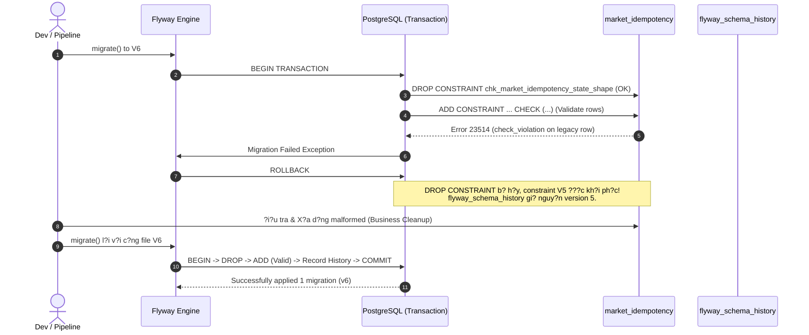

# M2-E7A: CHECK/NULL, Flyway Forward Migration v? DDL Rollback Tr?n D? Li?u C? Kh?ng H?p L?

**M? th? nghi?m:** M2-E7A
**M?i tr??ng th? nghi?m:** Java 22, Testcontainers PostgreSQL 16.15 (image `postgres:16-alpine`), Flyway 10.10.0, Spring Boot 3.3.4
**B?ng ch?ng ki?m ch?ng:** `docs/evidence/prompt20/migration-observations.json` & `docs/evidence/prompt20/idempotency-observations.json`
**Tr?ng th?i ki?m th?:** 3/3 Acceptance Tests PASS (MG1, MG2, MG3), 10/10 Observation Sets Validated, Full Reactor PASS (Core Lab: 34 tests, Backend App: 85 tests)

---

## 1. Gi?i Thi?u & M? H?nh T? Duy: Quy ??nh M?i Tr?n Kho H?ng C?

H?y t??ng t??ng m?t kho h?ng ?ang ho?t ??ng:
- Ban ??u, kho c? m?t quy ??nh ??n gi?n: m?i ??n h?ng ? tr?ng th?i "?ANG X? L?" (`PROCESSING`) th? ch?a c? m? xu?t kho (`purchase_id`) hay m? k?t qu? (`result_code`). Khi ??n h?ng chuy?n sang "HO?N TH?NH" (`COMPLETED`), ??n h?ng ph?i c? m? k?t qu? v? m? xu?t kho t??ng ?ng.
- Nh?ng ng??i vi?t n?i quy ban ??u (Migration V5) ?? vi?t m?t c?u ?i?u ki?n m? h?. Trong SQL ba gi? tr? (Three-Valued Logic), khi m?t gi? tr? l? `NULL`, ph?p so s?nh ??ng th?c cho ra `UNKNOWN` ch? kh?ng ph?i `FALSE`. Do c? ch? c?a `CHECK constraint`, h? th?ng kho h?ng ?? v? t?nh ch?p nh?n nh?ng ki?n h?ng "HO?N TH?NH" nh?ng c? k?t qu? l?n m? xu?t kho ??u b? b? tr?ng (`COMPLETED / null / null`).
- Khi ng??i qu?n l? ph?t hi?n ra s? h? n?y v? mu?n ban h?nh quy ??nh m?i chu?n x?c h?n (Migration V6), h? nh?n ra m?t s? th?t quan tr?ng: **vi?t m?t quy ??nh ??ng ch?a bao gi? l? ?? n?u trong kho ?ang t?n t?i nh?ng ki?n h?ng c? vi ph?m quy ??nh m?i ??.**

N?u ta c? ?p quy t?c m?i l?n m?t b?ng d? li?u ?ang c? "h?ng l?i", c? s? d? li?u s? ph?n ?ng ra sao? H? th?ng migration s? l?m g?? V? t?i sao m?t l?p tr?nh vi?n chuy?n nghi?p kh?ng bao gi? ???c ph?p quay l?i s?a file quy ??nh c? V5? ?? ch?nh l? tr?ng t?m c?a lab M2-E7A.

---

## 2. B?n Ch?t Ba Gi? Tr? (3-Valued Logic) & L? H?ng CHECK Constraint Trong V5

### 2.1. TRUE, FALSE v? UNKNOWN trong SQL

Trong chu?n SQL v? PostgreSQL, bi?u th?c logic kh?ng ch? c? hai gi? tr? `TRUE` / `FALSE` m? c? ba gi? tr?: `TRUE`, `FALSE`, v? `UNKNOWN` (ph?t sinh khi t?nh to?n v?i `NULL`).

| To?n t? | Bi?u th?c | K?t qu? Logic |
|---|---|---|
| Equality v?i NULL | `'SUCCESS' = NULL` | `UNKNOWN` |
| AND v?i UNKNOWN | `TRUE AND UNKNOWN` | `UNKNOWN` |
| OR v?i UNKNOWN | `FALSE OR UNKNOWN` | `UNKNOWN` |

### 2.2. S? Kh?c Bi?t Gi?a WHERE v? CHECK Constraint

??y l? c?u h?i ph?ng v?n kinh ?i?n l?m b?i r?i r?t nhi?u k? s? backend:

- **M?nh ?? `WHERE`**: Ch? gi? l?i c?c b?n ghi c? bi?u th?c ??nh gi? l? **`TRUE`**. B?t k? b?n ghi n?o ??nh gi? ra `FALSE` ho?c `UNKNOWN` ??u b? **lo?i b?** (filter out).
- **R?ng bu?c `CHECK constraint`**: T? ch?i b?n ghi khi v? ch? khi bi?u th?c ??nh gi? l? **`FALSE`**. N?u bi?u th?c ??nh gi? l? **`TRUE`** ho?c **`UNKNOWN`**, PostgreSQL **ch?p nh?n (accept)** b?n ghi ??!

> *Theo t?i li?u ch?nh th?c PostgreSQL 16 (Section 5.4.1):*
> *"It should however be noted that a check constraint is satisfied if the check expression evaluates to true or the null value. Since most expressions evaluate to the null value if any operand is null, they will not prevent null values in the constrained columns."*

### 2.3. L? H?ng C? Th? Trong V5

Trong `V5__create_market_idempotency.sql`, r?ng bu?c ban ??u ???c vi?t:

```sql
CONSTRAINT chk_market_idempotency_state_shape CHECK (
    (state = 'PROCESSING' AND result_code IS NULL AND purchase_id IS NULL)
    OR
    (state = 'COMPLETED' AND (
        (result_code = 'SUCCESS' AND purchase_id IS NOT NULL)
        OR
        (result_code = 'NOT_AVAILABLE' AND purchase_id IS NULL)
    ))
)
```

Khi m?t row c? `state = 'COMPLETED'`, `result_code = NULL`, `purchase_id = NULL`:
1. V? tr?i: `('COMPLETED' = 'PROCESSING' ...)` -> `FALSE`.
2. V? ph?i:
   - `result_code = 'SUCCESS'` -> `NULL = 'SUCCESS'` -> `UNKNOWN`.
   - `purchase_id IS NOT NULL` -> `NULL IS NOT NULL` -> `FALSE`.
   - `UNKNOWN AND FALSE` -> `FALSE`.
   - T??ng t?, nh?nh `result_code = 'NOT_AVAILABLE'` -> `UNKNOWN AND TRUE` -> `UNKNOWN`.
   - K?t h?p hai nh?nh: `FALSE OR UNKNOWN` -> `UNKNOWN`.
   - V? ngo?i c?ng: `state = 'COMPLETED' AND UNKNOWN` -> `TRUE AND UNKNOWN` -> **`UNKNOWN`**.
3. To?n b? `CHECK`: `FALSE OR UNKNOWN` -> **`UNKNOWN`**.
4. V? k?t qu? l? `UNKNOWN`, PostgreSQL **cho ph?p l?u d?ng n?y v?o DB**!

?i?u n?y cho ph?p d? li?u v? ngh?a xu?t hi?n trong b?ng: tr?ng th?i ?? xong (`COMPLETED`) nh?ng kh?ng ai bi?t k?t qu? l? g? (`result_code IS NULL`).

---

## 3. NOT NULL C?ng vs R?ng Bu?c Ph? Thu?c Tr?ng Th?i

T?i sao ta kh?ng ??n gi?n ??t `result_code VARCHAR(32) NOT NULL` tr?n c?t?
- V? trong b?ng idempotency, b?n ghi c? v?ng ??i hai giai ?o?n:
  1. Khi m?t giao d?ch ?ang ch?y (`state = 'PROCESSING'`), n? **b?t bu?c** ch?a c? k?t qu? (`result_code` ph?i l? `NULL`) v? ch?a c? ??n h?ng (`purchase_id` ph?i l? `NULL`).
  2. Ch? khi giao d?ch ho?n t?t (`state = 'COMPLETED'`), `result_code` m?i ???c ph?p c? gi? tr? v? kh?ng ???c ph?p `NULL`.
- N?u ??t `NOT NULL` c?ng tr?n c?t, ta s? ch?n ??ng tr?ng th?i `PROCESSING`, ph? v? ho?n to?n c? ch? claim kh?a idempotency.
- Do ??, ta b?t bu?c ph?i s? d?ng **r?ng bu?c to?n v?n c? ?i?u ki?n ph? thu?c tr?ng th?i (state-dependent shape constraint)**:

```sql
-- S?a ??i trong V6:
(state = 'COMPLETED' AND result_code IS NOT NULL AND (
    (result_code = 'SUCCESS' AND purchase_id IS NOT NULL)
    OR
    (result_code = 'NOT_AVAILABLE' AND purchase_id IS NULL)
))
```

B?ng c?ch th?m `result_code IS NOT NULL`, khi `result_code` l? `NULL`, bi?u th?c `result_code IS NOT NULL` tr? v? `FALSE` d?t kho?t, k?o to?n b? v? `COMPLETED` v? `FALSE`, khi?n PostgreSQL t? ch?i v?i l?i SQLSTATE `23514` (`check_violation`).

---

## 4. T?i Sao Ph?i Forward Migration (V6) Thay V? S?a V5?

M?t nguy?n t?c s?ng c?n trong qu?n tr? c? s? d? li?u chuy?n nghi?p: **Migration ?? ???c commit v? deploy l?n m?i tr??ng ngo?i l? b?t bi?n (immutable).**

1. **Flyway Checksum Validation:** Flyway l?u m? b?m CRC32/SHA-256 c?a t?ng file migration v?o b?ng `flyway_schema_history`. N?u s?a tr?c ti?p file V5, trong l?n kh?i ??ng ti?p theo tr?n b?t k? m?i tr??ng n?o ?? ch?y V5 (Staging, Pre-prod, Production), Flyway s? n?m ngo?i l?:
   ```text
   FlywayException: Validate failed: Migration checksum mismatch for migration version 5
   ```
   ?ng d?ng s? d?ng kh?i ??ng ho?n to?n (crash on startup).
2. **Fresh Install vs Production Upgrade:**
   - Tr?n m?y ph?t tri?n c?c b?, b?n c? th? x?a s?ch database (`dropdb`) v? ch?y l?i t? ??u; khi ?? s?a V5 tr?ng c? v? "g?n g?ng" v? pass test.
   - Nh?ng tr?n Production v?i h?ng tri?u ng??i d?ng, b?n **kh?ng th? x?a database**. DB th?c t? ?ang ? schema V5 v? ch?a d? li?u s?ng.
3. **T?nh Ti?n Tr?nh (Forward-only):** M?i s? thay ??i v? quy t?c d? li?u ??u ph?i ???c bi?u di?n b?ng m?t b??c ?i m?i: t?o file `V6__fix_market_idempotency_state_shape.sql`.

---

## 5. DDL Rollback Trong PostgreSQL & Gi?i H?n C?a Flyway

### 5.1. PostgreSQL H? Tr? Transactional DDL

Kh?ng gi?ng nh? MySQL hay Oracle (n?i h?u h?t c?u l?nh DDL t? ??ng commit v? kh?ng th? rollback), PostgreSQL h? tr? **Transactional DDL** cho ph?n l?n c?c l?nh schema (ngo?i tr? m?t s? l?nh nh? `CREATE DATABASE`, `VACUUM`, `CREATE INDEX CONCURRENTLY`).

Khi Flyway th?c thi m?t file migration, Flyway b?c to?n b? n?i dung file ?? trong m?t database transaction:
```sql
BEGIN;
ALTER TABLE market_idempotency DROP CONSTRAINT chk_market_idempotency_state_shape;
ALTER TABLE market_idempotency ADD CONSTRAINT chk_market_idempotency_state_shape CHECK (...);
-- Ghi nh?n v?o flyway_schema_history
COMMIT;
```

### 5.2. Chuy?n G? X?y Ra Khi B?ng Ch?a D? Li?u C? Kh?ng H?p L??

K?ch b?n MG3 trong lab t?i hi?n ch?nh x?c t?nh hu?ng n?y:
1. Schema ?ang ? V5.
2. B?ng ?ang ch?a 1 d?ng h?p l? (`PROCESSING`) v? 1 d?ng malformed (`COMPLETED / null / null`).
3. Flyway ch?y V6:
   - B??c 1: `DROP CONSTRAINT` th?nh c?ng trong transaction.
   - B??c 2: `ADD CONSTRAINT` ki?m tra to?n b? c?c d?ng hi?n c? trong b?ng (table scan validation). Ph?t hi?n d?ng malformed vi ph?m bi?u th?c m?i.
   - PostgreSQL l?p t?c n?m l?i SQLSTATE `23514` (`check_violation`).
   - Transaction c?a Flyway b? **`ABORT`** v? k?ch ho?t **`ROLLBACK`**.

### 5.3. B?ng Ch?ng Th?c Nghi?m T? Lab MG3

K?t qu? ?o ??c t? lab PostgreSQL th?t trong `migration-observations.json`:
- **L?nh `DROP CONSTRAINT` c? b? rollback kh?ng?** **C?.** Khi c?u l?nh `ADD CONSTRAINT` b? fail, transaction rollback ho?n to?n, kh?i ph?c l?i r?ng bu?c c? c?a V5 (`oldConstraintRestored = true`).
- **D? li?u trong b?ng c? b? m?t m?t kh?ng?** **KH?NG.** C? d?ng h?p l? v? d?ng malformed ??u c?n nguy?n v?n.
- **B?ng `flyway_schema_history` c? b? ghi nh?n V6 fail kh?ng?** Trong h?p ??ng transactional c?a PostgreSQL, b?n ghi V6 ch?a h? ???c commit. Sau rollback, s? l??ng b?n ghi V6 trong history l? **0** (`v6HistoryCountAfterFailure = 0`), schema version v?n gi? nguy?n l? **5**.
- **Kh?ng c?n `flyway repair`!** V? transaction ?? rollback s?ch s?, schema history kh?ng b? ? tr?ng th?i d? dang (`failed`). Sau khi ti?n h?nh d?n d?p d?ng r?c nghi?p v? (`DELETE FROM market_idempotency WHERE state='COMPLETED' AND result_code IS NULL`), ta ch? c?n ch?y l?i ??ng file V6 (v?i SHA-256 hash nguy?n v?n), migration s? th?nh c?ng 100% (`retrySuccess = true`).



---

## 6. ? Ngh?a C?a `migrate`, `validate`, v? `repair`

L?p tr?nh vi?n th??ng hi?u nh?m c?ng d?ng c?a c?c l?nh Flyway:

1. **`flyway:migrate`**: Qu?t th? m?c migration, so s?nh v?i `flyway_schema_history`, th?c thi c?c file migration m?i theo th? t? version.
2. **`flyway:validate`**: Ki?m tra c?c migration ?? ?p d?ng tr?n DB c? c?n kh?p checksum v? t?n file v?i m? ngu?n hi?n t?i hay kh?ng. Gi?p ph?t hi?n s?m vi?c ai ?? v? t?nh s?a file c?.
3. **`flyway:repair`**: **CH? s?a ??i metadata c?a Flyway**, tuy?t ??i **KH?NG can thi?p v?o b?ng d? li?u nghi?p v?**.
   - `repair` x?a c?c d?ng migration b? ??nh d?u `failed = true` (th??ng x?y ra tr?n c?c database kh?ng h? tr? transactional DDL nh? MySQL).
   - `repair` c?n ch?nh l?i checksum c?a c?c file ?? apply n?u c? s? thay ??i ???c ph? duy?t.
   - `repair` **kh?ng bao gi?** t? ??ng s?a d?ng `COMPLETED / null / null` trong b?ng `market_idempotency`.

---

## 7. X? L? D? Li?u L?i Tr?n Production: Kh?ng T? ? Ph?ng ?o?n

Trong m?i tr??ng th?c t?, n?u g?p d? li?u vi ph?m khi ch?y migration:
1. **Kh?ng bao gi? t? ? s?a d? li?u theo c?m t?nh:**
   - B?n kh?ng th? t? ??ng bi?n m?t b?n ghi `COMPLETED / null / null` th?nh `result_code = 'SUCCESS'` hay `'NOT_AVAILABLE'`. Li?u ti?n c?a kh?ch h?ng ?? b? tr? ch?a? H?ng trong kho ?? xu?t kho th?c t? ch?a?
2. **Quy tr?nh chu?n k? thu?t:**
   - Ph?n t?ch nguy?n nh?n g?c (root-cause analysis): l?i code ? version n?o ?? t?o ra d?ng n?y?
   - ??i so?t nghi?p v? (business reconciliation): ??i chi?u log ?ng d?ng, webhook c?ng thanh to?n ho?c h?a ??n.
   - Vi?t data migration script c? ki?m so?t (pre-migration cleanup) ?? ??a d? li?u v? tr?ng th?i h?p l? tr??c khi ?p d?ng schema constraint m?i.

---

## 8. B?ng T?ng H?p Ki?m Nghi?m Th?c T? (MG1 ? MG3)

| K?ch b?n | M?c ti?u | K?t qu? mong ??i | Gi? tr? ?o th?c t? (Observed) | Tr?ng th?i |
|---|---|---|---|---|
| **MG1** | N?ng c?p t? V5 l?n V6 khi d? li?u c? h?p l? | V5 ch?p nh?n malformed; V6 th?nh c?ng; d? li?u b?o to?n; migrate l?p l?i kh?ng sinh version m?i | `v5MalformedAccepted`: true<br/>`v6Success`: true<br/>`validDataPreserved`: true<br/>`repeatMigrationCount`: 0<br/>`historyCount`: 6 | **PASS** |
| **MG2** | Ki?m ch?ng 8 tr??ng h?p truth table sau V6 | Ch? 3 tr?ng th?i h?p l? ???c ACCEPT; 5 tr?ng th?i sai b? REJECT v?i SQLSTATE 23514; row nguy?n v?n sau UPDATE l?i | 8/8 combinations match expected exactly.<br/>`updateRejected`: true<br/>`updateSqlState`: "23514"<br/>`rowIntactAfterUpdateFailure`: true | **PASS** |
| **MG3** | Rollback DDL khi g?p d? li?u c? l?i v? retry | Migration fail v?i 23514; DDL rollback kh?i ph?c constraint c?; history s?ch; retry c?ng hash th?nh c?ng | `migrationFailureSqlState`: "23514"<br/>`oldConstraintRestored`: true<br/>`v6HistoryCountAfterFailure`: 0<br/>`v6FileHashUnchanged`: true<br/>`retrySuccess`: true<br/>`finalHistoryCount`: 6 | **PASS** |

---

## 9. K?t Lu?n Ki?n Tr?c

1. **Hi?u s?u c? ch? ng?n ng?:** SQL 3-valued logic l? ngu?n g?c c?a nhi?u l?i b?o m?t v? to?n v?n d? li?u ti?m ?n. `CHECK` ch?p nh?n `UNKNOWN`, do ?? c?c bi?u th?c ph? thu?c tr?ng th?i lu?n ph?i c? `IS NOT NULL` b?o v? r? r?ng.
2. **T?n tr?ng t?nh b?t bi?n:** Kh?ng bao gi? s?a file migration c? ?? b?n giao. M?i c?i ti?n ??u ph?i l? b??c ?i ti?p theo (Forward Migration).
3. **Hi?u r? n?n t?ng database:** PostgreSQL h? tr? Transactional DDL gi?p b?o v? h? th?ng to?n v?n khi migration th?t b?i. Hi?u ???c ranh gi?i gi?a DDL transaction v? data cleanup gi?p k? s? t? tin x? l? s? c? database ? quy m? l?n.
